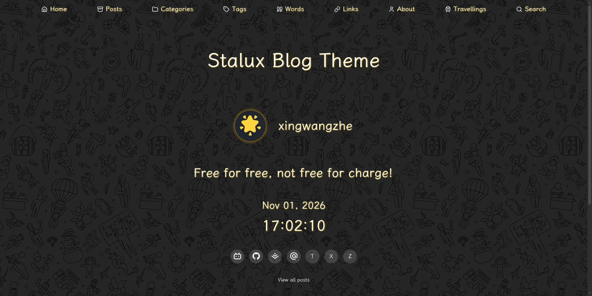

[中文文档](./README_CN.md) | English

[](https://github.com/xingwangzhe/stalux/actions/workflows/ci.yml)
[](https://www.npmjs.com/package/@xingwangzhe/stalux)
[](LICENSE)

# Stalux

**A modern, dark, glassmorphism-styled Astro blog theme.**

Built for content-first reading: per-page CJK font subsets, Pagefind full-text search, PhotoSwipe lightbox, Mermaid and math rendering, Waline comments, Swup view transitions, plus AI-friendly endpoints such as `llms.txt` and WebMCP. Use it as an npm plugin in an existing project or as a source template for deeper customization.

[Live demo](https://stalux.needhelp.icu) · [Documentation](./docs/README.md) · [Quick start](#quick-start) · [Issues](https://github.com/xingwangzhe/stalux/issues)

<p align="center">
  <a href="https://stalux.needhelp.icu">
    
  </a>
</p>

## Features

- **Dark glassmorphism design** with 42 switchable maximalist backgrounds and a consistent glass surface across navigation, cards and footer.
- **Per-page CJK font subsets** built with Rust / N-API: each page gets a content-addressed WOFF2 subset, and pages with the same character set share the file.
- **Search that handles Chinese** via a Pagefind full-text index plus a sharded CJK substring index with single-character, NFKC and multi-word queries.
- **Markdown, ready to go**: PhotoSwipe lightbox, image captions, Mermaid, Temml math and Expressive Code line numbers are injected by the theme integration.
- **Comments and feeds**: Waline comments, RSS / Atom, sitemap, `llms.txt` / `llms-full.txt`.
- **Smooth navigation**: Swup owns soft navigation, replaces only the main content area, and keeps background, navigation and footer stable.
- **AI-friendly**: read-only in-page WebMCP tools, Markdown post export, an OpenAPI description and build-time social cards.
- **Zero-config integrations**: one `stalux()` call bundles sitemap, Expressive Code and Markdown plugins; site metadata lives in YAML.
- **Customizable**: one `accentColor` changes the theme color, 30+ components can be overridden, and the UI ships in English and Chinese.

## Quick start

### Plugin mode (recommended)

```bash
bun create astro                    # Choose the minimal template
cd myblog
bun add @xingwangzhe/stalux         # Theme and all dependencies
bunx stalux init                    # Generate the stalux/ content directory
```

Configure `astro.config.ts`:

```ts title="astro.config.ts"
import { defineConfig } from "astro/config";
import stalux from "@xingwangzhe/stalux";

export default defineConfig({
    output: "static",
    site: "https://example.com",
    integrations: [stalux({ contentDir: "stalux" })],
});
```

Create `src/content.config.ts`:

```ts title="src/content.config.ts"
import { defineCollections } from "@xingwangzhe/stalux/schemas/collections";

export const collections = defineCollections({ contentDir: "stalux" });
```

```bash
bun run dev   # http://localhost:4321
```

`stalux init` only creates configuration and sample content under `stalux/`; it never overwrites an existing `package.json`, `astro.config.ts` or `src/content.config.ts`.

### Source template mode

```bash
git clone https://github.com/xingwangzhe/stalux.git my-blog
cd my-blog
bun install
bun run dev
```

> Requires Node.js 26 or newer; Bun is recommended. See [Getting started](./docs/GETTING-STARTED.md) for complete steps, integration options and the content layout.

## Configuration

Site metadata, navigation, author, comments and analytics live in YAML under `stalux/config/`. Changing the theme color takes one line:

```yaml title="stalux/config/site.yml"
accentColor: "#EAB308"
```

`accentColor` accepts a six-digit HEX value and drives both the theme and Waline accents. See [Configuration](./docs/CONFIGURATION.md) for every field.

## Deployment

```bash
bun run build     # Build the static site into dist/
bun run preview   # Preview the production build locally
```

`dist/` can be deployed to any static host. The repository ships an EdgeOne Pages configuration (pinned Bun 1.4.4 + `--frozen-lockfile`); cache directories, output checks and timezone notes are covered in [Deployment](./docs/DEPLOYMENT.md).

## Documentation

The detailed documentation is currently maintained in Chinese.

| Document | Contents |
| --- | --- |
| [Getting started](./docs/GETTING-STARTED.md) | Requirements, both install modes, layout, commands, diagnostics |
| [Configuration](./docs/CONFIGURATION.md) | Every `stalux/config/*.yml` field, color, weather, comments, AI discovery |
| [Features](./docs/FEATURES.md) | Typewriter, captions, lightbox, code theme, archives, soft navigation, backgrounds |
| [Fonts](./docs/FONTS.md) | Per-page CJK subsets, caches, font licenses |
| [Search](./docs/SEARCH.md) | Pagefind + CJK index, `searchKeywords`, fallbacks |
| [Analytics](./docs/ANALYTICS.md) | Google Analytics, Clarity, Umami, Vercount |
| [Performance](./docs/PERFORMANCE.md) | Visibility-based loading, first-screen CSS, route preload, backgrounds |
| [Deployment](./docs/DEPLOYMENT.md) | Static build, EdgeOne, caches, output checks |
| [WebMCP](./docs/WEBMCP.md) | In-page AI tools, data sources, enable/disable, polyfill |
| [Social cards](./docs/SOCIAL-CARDS.md) | `og:image` / `cover` priority and build-time generation |
| [Components](./docs/COMPONENTS.md) | Starlight-style component overrides |
| [License](./docs/LICENSING.md) | MIT theme code and font license scope |

The full index, including maintainer docs, is in [docs/README.md](./docs/README.md).

## License

Theme code is [MIT licensed](LICENSE). Bundled fonts (LXGW WenKai, Google Sans Code, Latin Modern Math and others) keep their own licenses; see [Licensing](./docs/LICENSING.md).
