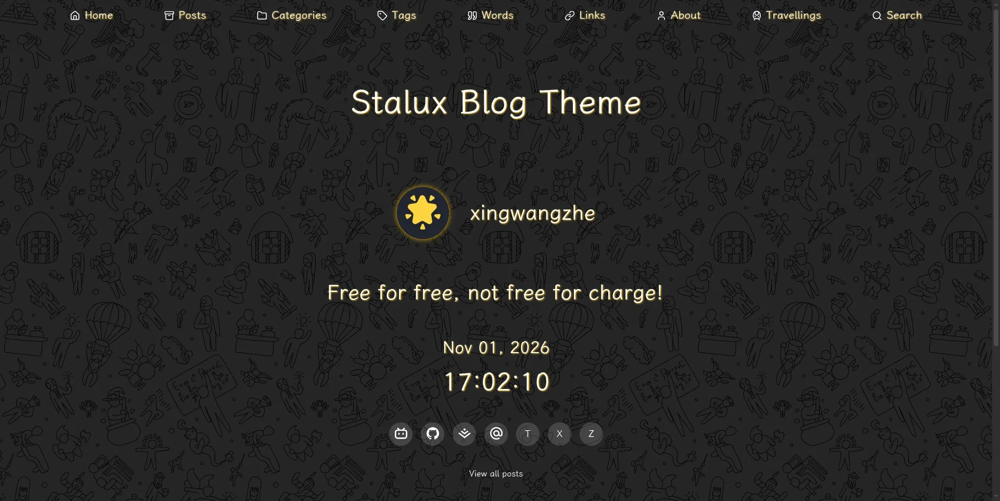

[English](./README.md) | 中文文档

[](https://github.com/xingwangzhe/stalux/actions/workflows/ci.yml)
[](https://www.npmjs.com/package/@xingwangzhe/stalux)
[](LICENSE)

# Stalux

**现代化、暗色、玻璃拟态风格的 Astro 博客主题。**

为内容阅读而生的静态博客主题：内置中文按页字体子集、Pagefind 全文搜索、PhotoSwipe 灯箱、Mermaid / 数学公式、Waline 评论和 Swup 视图过渡，同时提供 `llms.txt`、WebMCP 等 AI 友好接口。既能作为 npm 插件装进现有项目，也能作为源码模板直接二次开发。

[在线演示](https://stalux.needhelp.icu) · [完整文档](./docs/README.md) · [快速开始](#快速开始) · [问题反馈](https://github.com/xingwangzhe/stalux/issues)

<p align="center">
  <a href="https://stalux.needhelp.icu">
    
  </a>
</p>

## 特性

- **暗色 + 玻璃拟态**：42 张可随机切换的极繁背景，导航、卡片和页脚保持统一的玻璃质感。
- **中文按页字体子集**：构建期用 Rust / N-API 为每页可见 CJK 文本生成内容寻址 WOFF2 子集，同字符集页面复用文件。
- **搜索与检索**：Pagefind 全文索引 + 分片 CJK 子串索引，支持单字、全半角规范化和多词查询。
- **开箱即用的 Markdown**：PhotoSwipe 灯箱、图片图注、Mermaid、Temml 数学公式、Expressive Code 行号，全部由主题集成自动注入。
- **评论与订阅**：Waline 评论、RSS / Atom、Sitemap、`llms.txt` / `llms-full.txt`。
- **顺滑导航**：Swup 接管软导航，只替换主内容区，提供有界入场动效并保留背景、导航和页脚。
- **AI 友好**：页面内 WebMCP 只读工具、文章 Markdown 导出、OpenAPI 描述和构建期分享卡片。
- **零配置集成**：`stalux()` 一行注入 sitemap、Expressive Code 和 Markdown 插件；站点信息全部走 YAML。
- **可定制**：`accentColor` 一键换色，30+ 组件可覆盖，支持英文 / 中文界面。

## 快速开始

### 插件模式（推荐）

```bash
bun create astro                    # 选择 minimal 空模板
cd myblog
bun add @xingwangzhe/stalux         # 主题及全部依赖
bunx stalux init                    # 生成 stalux/ 内容目录
```

配置 `astro.config.ts`：

```ts title="astro.config.ts"
import { defineConfig } from "astro/config";
import stalux from "@xingwangzhe/stalux";

export default defineConfig({
    output: "static",
    site: "https://example.com",
    integrations: [stalux({ contentDir: "stalux" })],
});
```

创建 `src/content.config.ts`：

```ts title="src/content.config.ts"
import { defineCollections } from "@xingwangzhe/stalux/schemas/collections";

export const collections = defineCollections({ contentDir: "stalux" });
```

```bash
bun run dev   # http://localhost:4321
```

`stalux init` 只生成 `stalux/` 下的配置和示例内容，不会覆盖已有的 `package.json`、`astro.config.ts` 或 `src/content.config.ts`。

### 源码模板模式

```bash
git clone https://github.com/xingwangzhe/stalux.git my-blog
cd my-blog
bun install
bun run dev
```

> 需要 Node.js 26 或更高版本，推荐使用 Bun。完整步骤、插件选项和目录结构见 [快速开始](./docs/GETTING-STARTED.md)。

## 常用配置

站点信息、导航、作者、评论和统计都在 `stalux/config/` 的 YAML 里。换主题色只需要：

```yaml title="stalux/config/site.yml"
accentColor: "#EAB308"
```

`accentColor` 接受六位 HEX，同时驱动主题与 Waline 的强调色。其余字段见 [配置说明](./docs/CONFIGURATION.md)。

## 部署

```bash
bun run build     # 生成静态站点到 dist/
bun run preview   # 本地预览生产产物
```

`dist/` 可直接部署到任意静态托管。仓库自带 EdgeOne Pages 配置（固定 Bun 1.4.4 + `--frozen-lockfile`）；缓存目录、产物检查和时区注意事项见 [部署](./docs/DEPLOYMENT.md)。

## 文档

| 文档 | 内容 |
| --- | --- |
| [快速开始](./docs/GETTING-STARTED.md) | 环境要求、两种安装方式、目录结构、开发命令、诊断日志 |
| [配置说明](./docs/CONFIGURATION.md) | `stalux/config/*.yml` 全量字段、主题色、天气、评论、AI 发现 |
| [功能行为](./docs/FEATURES.md) | 打字机、图注、灯箱、代码主题、归档、软导航、背景 |
| [字体](./docs/FONTS.md) | 中文按页字体子集、缓存、字体许可 |
| [搜索](./docs/SEARCH.md) | Pagefind + CJK 索引、`searchKeywords`、降级行为 |
| [统计](./docs/ANALYTICS.md) | Google Analytics、Clarity、Umami、Vercount |
| [性能与加载](./docs/PERFORMANCE.md) | 按可见性加载、首屏 CSS、路由预热、背景资源 |
| [部署](./docs/DEPLOYMENT.md) | 静态构建、EdgeOne、缓存目录、产物检查 |
| [WebMCP](./docs/WEBMCP.md) | 页面内 AI 工具、数据源、启停、polyfill |
| [文章分享卡片](./docs/SOCIAL-CARDS.md) | `og:image` / `cover` 优先级与构建期生成 |
| [组件覆盖](./docs/COMPONENTS.md) | Starlight 风格组件覆盖 |
| [许可](./docs/LICENSING.md) | 主题 MIT 与字体许可范围 |

完整索引与维护文档见 [docs/README.md](./docs/README.md)。

## 许可证

主题代码采用 [MIT License](LICENSE)。内置字体（LXGW WenKai、Google Sans Code、Latin Modern Math 等）保留各自许可，详见 [许可说明](./docs/LICENSING.md)。
